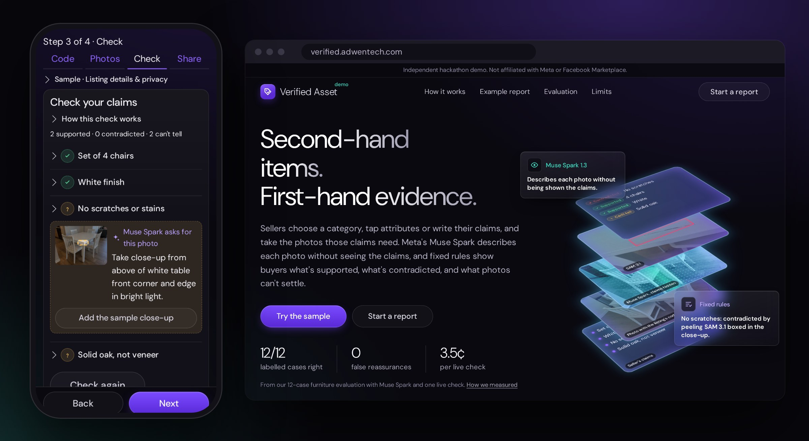
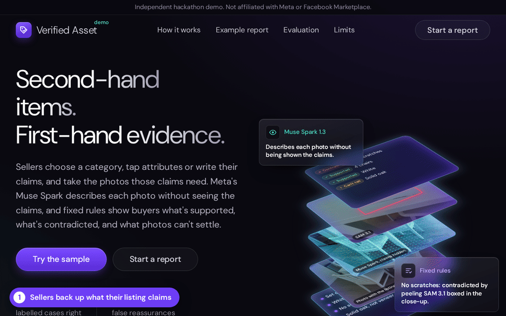
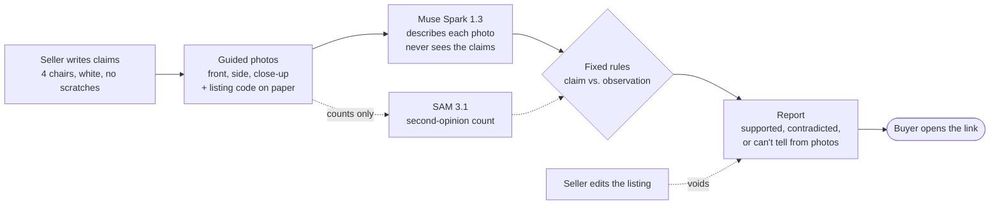

<p align="center">
  
</p>

<h1 align="center">Verified Asset</h1>

<p align="center">
  <b>Before you drive across town or pay, see which of the seller's claims the photos back up.</b><br>
  Evidence reports for second-hand item listings, built on Meta's Muse Spark and SAM.
</p>

<p align="center">
  <a href="https://verified.adwentech.com"></a>
  <a href="https://github.com/cpu-16/verified-asset/actions/workflows/tests.yml"></a>
  
  
  <a href="LICENSE"></a>
</p>

<p align="center">
  <a href="#how-it-works">How it works</a> ·
  <a href="#why-the-model-doesnt-judge-the-claims">Why blind</a> ·
  <a href="#what-a-report-is-and-isnt">What a report is</a> ·
  <a href="#run-it">Run it</a> ·
  <a href="#evaluation">Evaluation</a>
</p>

---

**Hackathon entry:** Startup track. **Use of Meta products:** Muse Spark 1.3 (blind observer, claim drafting, missing-photo planning) and SAM 3.1 (second-opinion counts, damage boxes) through the Meta API; Muse Glimmer 30B locally, for evaluation only. See [Built on Meta models](#built-on-meta-models) and the [provenance record](docs/provenance.md).

Local pickup is where second-hand deals go wrong: the "set of six" has four chairs, the "no scratches" top has a gouge, and you find out after an hour in traffic. Marketplace already helps sellers write and price listings. Verified Asset answers a different question: **which of this listing's claims does the photo evidence support, which does it contradict, and which can photos not settle at all?**

The seller chooses Furniture, Phones & tablets, Electronics & gaming, Clothing & shoes, or Kitchen & home, taps attribute suggestions or writes their claims, takes the few photos those claims need with the listing's code written on paper, and gets a report link to paste into the listing. Buyers open it without signing up.

On the [live site](https://verified.adwentech.com), **Try the sample** runs the whole seller flow on the dining set below. It replays recorded Muse Spark observations of those photos, so it needs no photos of your own and makes no API call. It starts without the close-up: the first check can't tell whether there are scratches, Spark's recorded plan asks for the close-up and marks where, and adding it turns the claim into a contradiction. Change "Set of 4 chairs" to 6 and check again to see another. The [demo guide](docs/demo-guide.md) walks through every screen with numbered screenshots.

<p align="center">
  
</p>

## How it works

**More than an image analyzer.** No model is asked whether a claim is true. Muse Spark describes each photo blind, without the claimed values; fixed rules decide each claim; when the photos can't settle one, Muse Spark plans the one photo that would, and the next blind check and the rules run on it; SAM 3.1 gives a second opinion on piece counts and boxes the damage Spark found; and the report is bound to the listing version and each photo's hash, so editing the listing voids it.



1. **Claims first.** Choose a category and tap fixed attribute suggestions, or write your own claim. Each claim gets a type: a piece count, a colour, no visible damage, or *other* (material, age, "works fine"). *Other* claims stay on the report, marked as something photos can't show. The seller can type the rows or press **Suggest claims**: Muse Spark reads only the description they wrote or dictated and proposes rows, marked as suggested, for them to keep or change before any photo is taken. Or they can **film the item instead**: the phone sends 10 still frames (never the video), Muse Spark drafts the title, description, counts and colour and picks the front, side and close-up, and the seller keeps or changes every line before anything is saved. It never drafts "no visible damage", and the report marks each claim it drafted.
2. **Only the photos the claims need.** A count needs the front and side; damage needs a close-up too. The listing's code goes on paper in the front photo.
3. **Blind observation.** Muse Spark gets one photo at a time, a strict JSON schema and the nouns to count. It never gets the claim sentences or the claimed number, colour or condition. Its prompt says text in a photo is evidence, not instructions; the evaluation has one injection probe, which is not a guarantee.
4. **Rules decide.** Plain Python compares each claim's type and value with the observations, and the sentence buyers read must name the same number or colour. A required photo that is blurry, dark or cut off, a count with no photo showing every piece, or a SAM count that disagrees with Spark makes the claim *can't tell*, and Muse Spark plans the exact photo that would help, marked on the seller's own photo.
5. **A report bound to what was checked.** The listing version, each photo's SHA-256 and the rules version go into a fingerprint. Editing the listing in Verified Asset voids its reports (edits made on Marketplace itself can't be seen), the seller can withdraw a report, and reports expire after 30 days.

<details>
<summary><b>The rules, claim by claim</b></summary>

| Claim | Photos | Supported | Contradicted | Otherwise |
|---|---|---|---|---|
| Piece count | front, side | one photo shows exactly that many, all in view | every piece is in view and the count differs | can't tell; asks for one photo with all of them in view |
| Colour | front | the claimed colour family is among the dominant colours | other colours are seen, not the claimed one | can't tell |
| No visible damage | front, side, close-up | no damage seen in any of them, *as photographed* | any visible damage | can't tell if a photo is unusable |
| No visible damage on a part | close-up | the part is counted as fully visible, with no damage located on it | damage is located on that part | asks for a complete close-up of that part |
| Label text | close-up | the entire transcribed text matches (case and spacing ignored) | never: text has no reliable label provenance | asks for a legible label close-up |
| Other | none | never | never | always *can't be checked from photos* |

Category suggestions are a fixed catalogue, with no AI or retrieval. New part and label rules have unit tests but have not been evaluated on labelled real photos across these categories. The recorded evaluation below remains limited to dining sets and sofas. Label text never certifies brand authenticity.

Photo-checkable claims also end in *can't tell* when a required photo is missing or marked unusable, and a count does when SAM 3.1 runs and disagrees with Spark. The code is [`app/adjudicate.py`](app/adjudicate.py); the model's instructions are in [`app/observe.py`](app/observe.py).
</details>

## Why the model doesn't judge the claims

On the same 12 labelled furniture cases we compared what ships, a detailed blind observation followed by the rules (without SAM), with a short prompt that shows the model the claim next to the photos and asks for a verdict.

| Observer | Blind + rules | Model judges the claim directly |
|---|---|---|
| **Muse Spark 1.3** | **12/12** correct, **0** false reassurances | 9/12, **2** false reassurances |
| Muse Glimmer 30B (local GPU) | 12/12, 0 | 9/12, 2 |

A *false reassurance* is a "supported" that should not have been. Both models, shown "Three seat cushions" next to a photo too dark to make out the sofa, said **supported**. Blind, they reported the photo as too dark and the rule refused to decide. Spark judging directly also called four plainly visible chairs "contradicted".

The two set-ups differ in their instructions as well as in who decides, so read this as evidence for the design rather than a clean measurement of one factor. It is a sanity check, not a benchmark: 12 furniture cases with synthetic photos, labels written before the first run and not changed since. Full tables, the injection probe and the code-reading results are in [`eval/results`](eval/results).

## What a report is and isn't

- **It is** a record of what specific photos showed about specific claims, on a specific listing version.
- **The listing's code** on paper, when the model reads it in a usable photo, is a signal against reused or downloaded photos. It doesn't prove when a photo was taken or that it wasn't edited, who owns the item, or that the seller still has it.
- **It isn't** proof of ownership, current possession, authenticity, function, full condition or the seller's trustworthiness. It never scores people.
- Edits made outside Verified Asset (on Marketplace itself) can't be detected; the report lists that limit on its page.

## Built on Meta models

| Model | Role |
|---|---|
| **Muse Spark 1.3** (Meta API) | The observer: one photo at a time, strict JSON schema, claim-blind |
| **Muse Spark 1.3** (Meta API, text only) | **Suggest claims**: turns the seller's description into claim rows they review. It never sees the photos, and runs at low reasoning effort (about 6 s and half a cent) |
| **Muse Spark 1.3** (Meta API, 10 video frames) | **Film it instead**: drafts the listing from frames the seller's phone takes from their video, and picks the photos. The draft is checked by the same blind pass; about 7 s and 2 cents at low reasoning effort |
| **Muse Spark 1.3** (Meta API, the seller's photos) | **Asks for the missing photo**: when a claim ends *can't tell*, Spark looks at the photos the seller has and plans the one shot that would settle it ("Photograph near right tabletop corner and edge closely from above"), marking the area on their photo. It gets neutral tasks such as "see every chair fully", never the claimed number, colour or text, and it decides nothing: the next blind check and the rules do. One shot covers every claim the same photo can settle; the plan stays on the seller's page |
| **SAM 3.1** (Meta API) | Second-opinion piece counts on checks that count pieces: when it runs and disagrees with Spark, the claim can't be decided. It also boxes the damage Spark found, on the seller's page only (the report keeps the written description) |
| **Muse Glimmer 30B** (local GPU) | Evaluation on the same observation prompt, with no API cost |

A real check of three photos with Spark and SAM took 6.5 s and $0.035 in API calls; checking the same photos again took 4 ms and made no API call ([measurement](eval/results/live-check.md)).

<details>
<summary><b>Spend controls</b></summary>

The public site is open to anyone, so every paid call is guarded:

- **Cache.** Observations are keyed by photo SHA-256, count nouns, model and prompt version, and shared across listings. SAM results are keyed by photo and phrase.
- **Per-listing quota.** At most `CHECKS_PER_LISTING_PER_DAY` (5) checks that reach a paid model, per listing, per UTC day.
- **Caps.** Before each paid call, an estimate is reserved against `SPEND_DAILY_USD` (2) and `SPEND_CAP_USD` (10). The ledger survives restarts and is shared by every worker on the same data directory. The real token cost is recorded after the call and can run slightly over the estimate.
- **SAM only when needed**, that is, when a claim counts pieces.
</details>

## Run it

```bash
uv sync
uv run pytest -q                      # app tests
node extension/test/check.mjs         # extension tests (needs Chromium)

# with Muse Spark
MODEL_API_KEY=... uv run uvicorn app.main:app --reload
# or, with MODEL_API_KEY unset, a local server with OpenAI-style image input and strict JSON-schema output, e.g. Muse Glimmer in LM Studio
LOCAL_MODEL_URL=http://127.0.0.1:1234/v1 LOCAL_MODEL_ID=muse-glimmer-30b uv run uvicorn app.main:app --reload
```

<details>
<summary><b>Configuration</b></summary>

| Variable | Default | Meaning |
|---|---|---|
| `MODEL_API_KEY` | none | Meta API key: Muse Spark observes, SAM gives second opinions |
| `LOCAL_MODEL_URL`, `LOCAL_MODEL_ID` | none, `muse-glimmer-30b` | Use a local OpenAI-compatible model instead |
| `DATA_DIR` | `data` | SQLite database, photos, caches and the spend ledger |
| `SPEND_CAP_USD`, `SPEND_DAILY_USD` | 10, 2 | Total and daily spending caps |
| `CHECKS_PER_LISTING_PER_DAY` | 5 | Paid checks per listing per UTC day |
| `SCAN_ENABLED` | unset | Any non-empty value turns on the buyer-side scan of a listing's own photos (roadmap; leave unset) |

[`deploy/`](deploy) has the systemd unit and the deploy script.
</details>

## Evaluation

```bash
LOCAL_MODEL_URL=http://127.0.0.1:1234/v1 uv run python -m eval.run --direct   # free, local
MODEL_API_KEY=... uv run python -m eval.run --direct                          # Muse Spark
```

Each photo's parsed observation is recorded by photo hash in [`eval/recordings`](eval/recordings), and each direct judgement by case, so a rerun only calls the model for what's missing. The cases and their labels are in [`eval/cases.json`](eval/cases.json). The whole Spark run, ablation included, was 22 calls and $0.22.

## Repository map

| Path | What's there |
|---|---|
| [`app/`](app) | FastAPI app: routes and pages (`main.py`), model adapters and spend guard (`observe.py`), SAM (`segment.py`), rules (`adjudicate.py`), claim types (`catalog.py`), reports (`reports.py`), storage (`store.py`) |
| [`extension/`](extension) | Chrome/Brave extension that shows a report's verdicts on the Marketplace item page that links to it |
| [`eval/`](eval) | Labelled cases, photos, recordings and results |
| [`tests/`](tests) | App tests; they run with the extension's on every push |
| [`docs/`](docs) | Decision record, planning architecture and provenance |

## What existed before the hackathon

This repository's history starts on October 27, 2026, after the October 26 kickoff. Its first commit imported planning documents (`docs/architecture.md` and the D-07 decision record). Before kickoff the team had a private research prototype (listing-review scripts, notebooks, offline tests) and product planning in a separate repository; none of that prototype's code or git history is included here. The [provenance record](docs/provenance.md) says what was excluded, what was imported, and who did what.

Built for the [Meta Global AI Developer Hackathon](https://cerebralvalley.ai/e/meta-ai-developer-hackathon) (October 26 to November 4, 2026), Startup track. Concept and product decisions: Jeff. Code: Gilberto. Both at AdwenTech. An independent demo, not affiliated with Meta or Facebook Marketplace.

## License

[MIT](LICENSE). Dependencies, model weights and third-party material keep their own terms.
