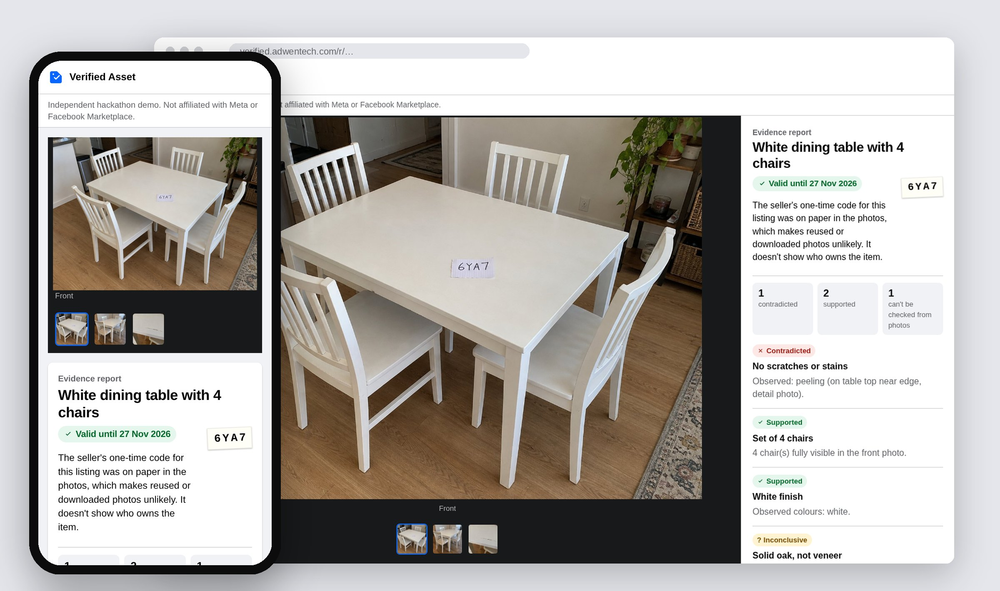
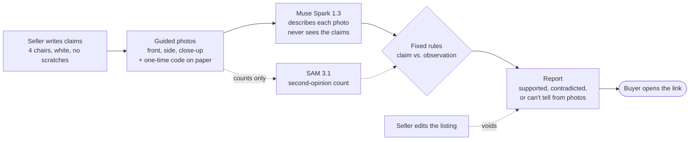

<p align="center">
  <picture>
    <source media="(prefers-color-scheme: dark)" srcset="docs/media/hero-dark.jpg">
    
  </picture>
</p>

<h1 align="center">Verified Asset</h1>

<p align="center">
  <b>Before you drive across town or pay, see which of the seller's claims the photos back up.</b><br>
  Evidence reports for second-hand furniture listings, built on Meta's Muse Spark and SAM.
</p>

<p align="center">
  <a href="https://verified.adwentech.com"></a>
  <a href="https://github.com/cpu-16/verified-asset/actions/workflows/tests.yml"></a>
  
  
  <a href="LICENSE"></a>
</p>

<p align="center">
  <a href="#how-it-works">How it works</a> ·
  <a href="#why-the-model-never-sees-the-claim">Why blind</a> ·
  <a href="#what-a-report-is-and-isnt">What a report is</a> ·
  <a href="#run-it">Run it</a> ·
  <a href="#evaluation">Evaluation</a>
</p>

---

Local pickup is where second-hand deals go wrong: the "set of six" has four chairs, the "no scratches" top has a gouge, and you find out after an hour in traffic. Marketplace already helps sellers write and price listings. Verified Asset answers a different question: **which of this listing's claims does the photo evidence support, which does it contradict, and which can photos not settle at all?**

The seller writes their claims, takes the few photos those claims need with a one-time code written on paper, and gets a report link to paste into the listing. Buyers open it without signing up.

<p align="center">
  
</p>

## How it works



1. **Claims first.** Each claim gets a type: a piece count, a colour, no visible damage, or *other* (material, age, "works fine"). *Other* claims stay on the report, marked as something photos can't show.
2. **Only the photos the claims need.** A count needs the front and side; damage needs a close-up too. The seller's one-time code goes on paper in the front photo.
3. **Blind observation.** Muse Spark gets one photo at a time and a strict JSON schema. It is told which nouns to count, never the claimed number, colour or condition. Text in the photo is treated as evidence, not instructions.
4. **Rules decide.** Plain Python compares claim and observation. A blurry or dark photo, a count that might hide pieces, or SAM disagreeing with Spark all end in *can't tell*, together with the photo that would settle it.
5. **A report bound to what was checked.** The listing version, each photo's SHA-256 and the rules version go into a fingerprint. Editing the listing voids the report, the seller can withdraw it, and it expires after 30 days.

<details>
<summary><b>The rules, claim by claim</b></summary>

| Claim | Photos | Supported | Contradicted | Otherwise |
|---|---|---|---|---|
| Piece count | front, side | one photo shows exactly that many, all in view | every piece is in view and the count differs | can't tell; asks for one photo with all of them in view |
| Colour | front | the claimed colour family is among the dominant colours | other colours are seen, not the claimed one | can't tell |
| No visible damage | front, side, close-up | no damage seen in any of them, *as photographed* | any visible damage | can't tell if a photo is unusable |
| Other | none | never | never | always *can't be checked from photos* |

Every claim also ends in *can't tell* when a required photo is missing, blurry, too dark or cut off, and a count does when SAM 3.1 and Spark disagree. The code is [`app/adjudicate.py`](app/adjudicate.py); the model's instructions are in [`app/observe.py`](app/observe.py).
</details>

## Why the model never sees the claim

We ran the same 12 labelled cases two ways: blind observation plus rules (what ships), and the model shown the claim next to the photos and asked to judge it.

| Observer | Blind + rules | Model judges the claim directly |
|---|---|---|
| **Muse Spark 1.3** | **12/12** correct, **0** false reassurances | 9/12, **2** false reassurances |
| Muse Glimmer 30B (local GPU) | 12/12, 0 | 9/12, 2 |

A *false reassurance* is a "supported" that should not have been. Both models, shown "Three seat cushions" next to a photo too dark to make out the sofa, said **supported**. Blind, they reported the photo as too dark and the rule refused to decide. Spark judging directly also called four plainly visible chairs "contradicted".

This is a sanity check, not a benchmark: 12 cases with synthetic photos, labels written before any run. Full tables, the injection probe and the code-reading results are in [`eval/results`](eval/results).

## What a report is and isn't

- **It is** a record of what specific photos showed about specific claims, on a specific listing version.
- **The one-time code** on paper makes reused or downloaded photos unlikely. It doesn't show who owns the item or that the seller has it now.
- **It isn't** proof of ownership, current possession, authenticity, function, full condition or the seller's trustworthiness. It never scores people.
- Edits made outside Verified Asset (on Marketplace itself) can't be detected; the report lists that limit on its page.

## Built on Meta models

| Model | Role |
|---|---|
| **Muse Spark 1.3** (Meta API) | The observer: one photo at a time, strict JSON schema, claim-blind |
| **SAM 3.1** (Meta API) | Second-opinion piece counts: if it disagrees with Spark, the claim can't be decided. It also locates observed damage, which stays off the public report |
| **Muse Glimmer 30B** (local, RTX 4090) | Evaluation and private runs on the same prompts, at no API cost |

A real check of three photos with Spark and SAM took 6.5 s and cost $0.035. Checking the same photos again took 4 ms and cost nothing.

<details>
<summary><b>Spend controls</b></summary>

The public site is open to anyone, so every paid call is guarded:

- **Cache.** Observations are keyed by photo SHA-256, count nouns, model and prompt version, and shared across listings. SAM results are keyed by photo and phrase.
- **Per-listing quota.** At most `CHECKS_PER_LISTING_PER_DAY` (5) checks that reach a paid model, per listing, per UTC day.
- **Caps.** `SPEND_DAILY_USD` (2) and `SPEND_CAP_USD` (10), enforced before each call, persisted across restarts and shared by every worker.
- **SAM only when needed**, that is, when a claim counts pieces.
</details>

## Run it

```bash
uv sync
uv run pytest -q                      # app tests
node extension/test/check.mjs         # extension tests (needs Chromium)

# with Muse Spark
MODEL_API_KEY=... uv run uvicorn app.main:app --reload
# or with any OpenAI-compatible local vision model, e.g. Muse Glimmer in LM Studio
LOCAL_MODEL_URL=http://127.0.0.1:1234/v1 LOCAL_MODEL_ID=muse-glimmer-30b uv run uvicorn app.main:app --reload
```

<details>
<summary><b>Configuration</b></summary>

| Variable | Default | Meaning |
|---|---|---|
| `MODEL_API_KEY` | none | Meta API key: Muse Spark observes, SAM gives second opinions |
| `LOCAL_MODEL_URL`, `LOCAL_MODEL_ID` | none, `muse-glimmer-30b` | Use a local OpenAI-compatible model instead |
| `DATA_DIR` | `data` | SQLite database, photos, caches and the spend ledger |
| `SPEND_CAP_USD`, `SPEND_DAILY_USD` | 10, 2 | Total and daily spending caps |
| `CHECKS_PER_LISTING_PER_DAY` | 5 | Paid checks per listing per UTC day |
| `SCAN_ENABLED` | off | Buyer-side scan of a listing's own photos (roadmap, off in production) |

Production runs as a systemd service behind a Cloudflare tunnel; see [`deploy/`](deploy).
</details>

## Evaluation

```bash
LOCAL_MODEL_URL=http://127.0.0.1:1234/v1 uv run python -m eval.run --direct   # free, local
MODEL_API_KEY=... uv run python -m eval.run --direct                          # Muse Spark
```

Each photo is observed once and the raw answer is recorded in [`eval/recordings`](eval/recordings), so a rerun only pays for photos it hasn't seen. The cases and their labels are in [`eval/cases.json`](eval/cases.json). The whole Spark run, ablation included, was 22 calls and $0.22.

## Repository map

| Path | What's there |
|---|---|
| [`app/`](app) | FastAPI app: routes and pages (`main.py`), model adapters and spend guard (`observe.py`), SAM (`segment.py`), rules (`adjudicate.py`), claim types (`catalog.py`), reports (`reports.py`), storage (`store.py`) |
| [`extension/`](extension) | Chrome/Brave extension that shows a report's verdicts on the Marketplace item page that links to it |
| [`eval/`](eval) | Labelled cases, photos, recordings and results |
| [`tests/`](tests) | 61 app tests; they run on every push |
| [`docs/`](docs) | Decision record, planning architecture and provenance |

## What existed before the hackathon

This repository contains **only work done during the event**, starting from an empty history on October 27, 2026. Before kickoff, the team had a private research prototype (listing-review scripts, notebooks, offline tests) and product planning; none of that code or its git history is included here. The [provenance record](docs/provenance.md) lists what was excluded and why.

Built for the [Meta Global AI Developer Hackathon](https://cerebralvalley.ai/e/meta-ai-developer-hackathon) (October 26 to November 4, 2026) by Jeff and Gilberto at AdwenTech. An independent demo, not affiliated with Meta or Facebook Marketplace.

## License

[MIT](LICENSE). Dependencies, model weights and third-party material keep their own terms.
