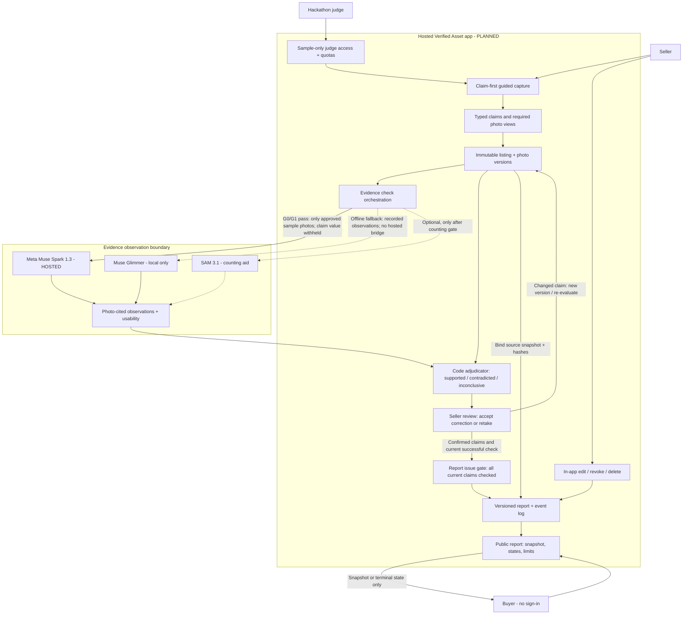

# Verified Asset — architecture (D-07 hackathon increment)

**Status:** the planning document from October 27, 2026, kept as the decision record. The [README](../README.md) describes what is built. Source of decisions: [D-07](decisions/D-07-hackathon-architecture.md). D-01–D-06 remain the production product decisions.

This diagram shows **conditional Architecture B**: hosted Muse Spark for claim-blind visual observations (after G0/G1), deterministic code for claim outcomes, and an immutable report lifecycle. Muse Glimmer is an explicit local fallback; SAM 3.1 is an optional future counting experiment, not part of the committed build.

Reader path: [overview](../README.md) → this planned architecture →
[provenance](provenance.md). Requirement traceability and the migration handoff
stay in the team's private pre-event repository.
The local fallback is a design option, not verified current worker availability;
use current workspace routing authorization before invoking any model.

## System architecture

## What is built, and what is still gated?

| Component | Verified status (October 27) | Acceptance evidence |
| --- | --- | --- |
| Muse Spark Model API | **G0 synthetic-image smoke passed:** image input and constrained JSON response | Furniture checks and latency not yet validated (G1) |
| Muse Glimmer via LM Studio | One phone-photo experimental inspection, not furniture evidence | Equal-case furniture comparator (G1) |
| Guided capture and typed furniture claims | **Planned**; existing checklist is phone-centric | Complete required views and retakes |
| Claim-blind observation adapter | **Planned** | Model never receives claimed value; returns observation and source photo reference |
| Deterministic policy adjudicator | **Planned**; prototype validates shape, not correctness | G2 unit tests: unprovable classes cannot receive supported; missing view inconclusive; failure yields no report |
| Listing, photo, check and report version storage | **Planned** | Immutable binding, explicit new check on retake, clock-based expiry tests |
| Hosted judge demo and buyer report | **Planned** | G3: new browser without seller login can complete sample flow in under three minutes |
| SAM 3.1 | **Excluded from critical path** | Only add if preregistered counting comparison shows meaningful improvement without new wrong outcomes |

## Contract and safety boundaries

1. **Model is observer, code is adjudicator.** The model sees a requested visual observation task and approved image, *not* the seller's expected claim value. Policy compares observations to typed claim values, tracks uncertainty and required views, and never converts uncheckable claims into assurances.
2. **Private photos stay local.** Only owned, consented, staged, metadata-stripped **demo-cleared** images can go to the Meta Model API after applicable terms are checked. Real seller photos are excluded from hosted inference under the existing policy until a separate production consent and processing decision is approved. The hosted judge demo cannot accept arbitrary private uploads under the sample-only mode.
3. **No invisible fallback.** Spark is promoted only after G0 (account, terms, cost controls) and G1 (pre-labelled furniture performance) pass. Otherwise the user sees an explicitly labelled local/replayed Glimmer route. A failed model check is a failure, *not* an `inconclusive` adjudication.
4. **Report truth is bound to a snapshot.** A report references the exact listing version, photo slots and hashes, successful check run, and rules version. In-app changes invalidate that issued report. Changes to an external Marketplace listing cannot be detected and are not promised.
5. **Report lifecycle is auditable.** On issuance, the public link shows the approved claim snapshot, date, per-claim status and D-03 limitations. On invalidation, revocation, expiry or deletion, the old link shows only its state. New report versions get new links. Raw captures never appear on a public report.
6. **Safety and spending controls.** Server holds API credentials; limit request size, concurrent jobs, test/demo usage and spend at the application level. A provider spend alert is not a hard cap. Log actual usage and measured cost excluding sponsor credits for the future commercial unit-economics test.

## Build sequence

- **G0:** hosted Muse Spark image/schema smoke **passed** on synthetic geometry; billing balance reported by Jeff, but demo-photo terms and application spending guardrails remain pending.
- **G1:** measure Spark and Glimmer with pre-registered furniture claims, especially wrong supports, missed contradictions, unjustified abstentions and photo quality.
- **G2:** implement and test typed claim workflow, observation-to-verdict rules, correction/re-check, immutable report and invalidation/revocation.
- **G3:** deploy and verify judge access from a fresh browser, showing clearly labelled live or recorded inference.

Hackathon scope: **Furniture/home goods only**. Production scope remains Furniture/home goods plus Clothing/accessories. Do not infer overall production readiness from one synthetic-image API call, historical offline tests or a polished demo.
