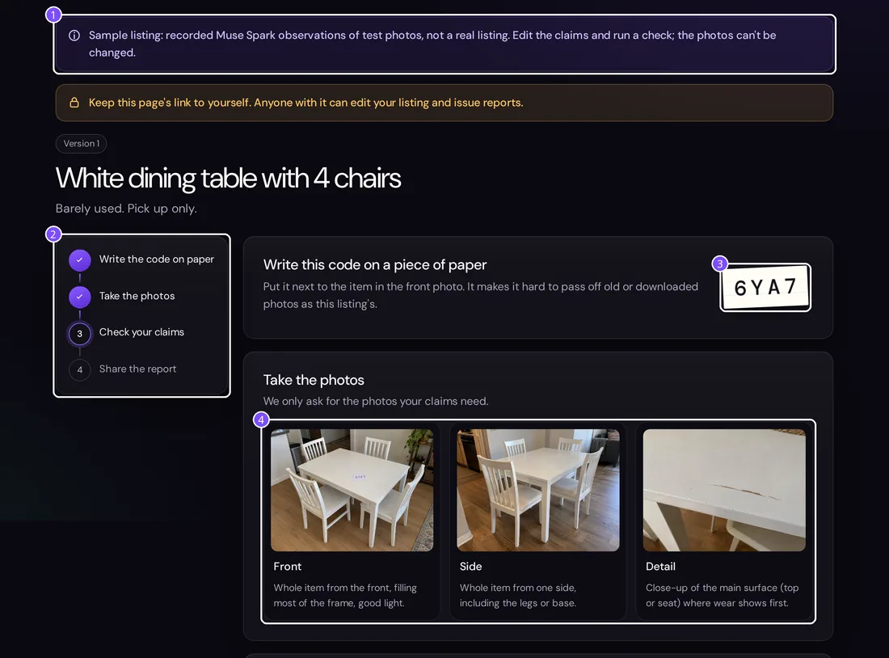
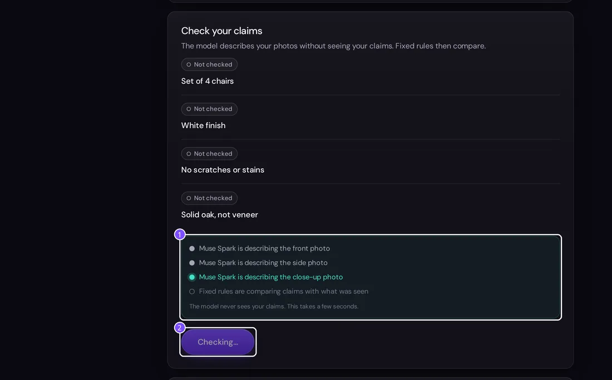
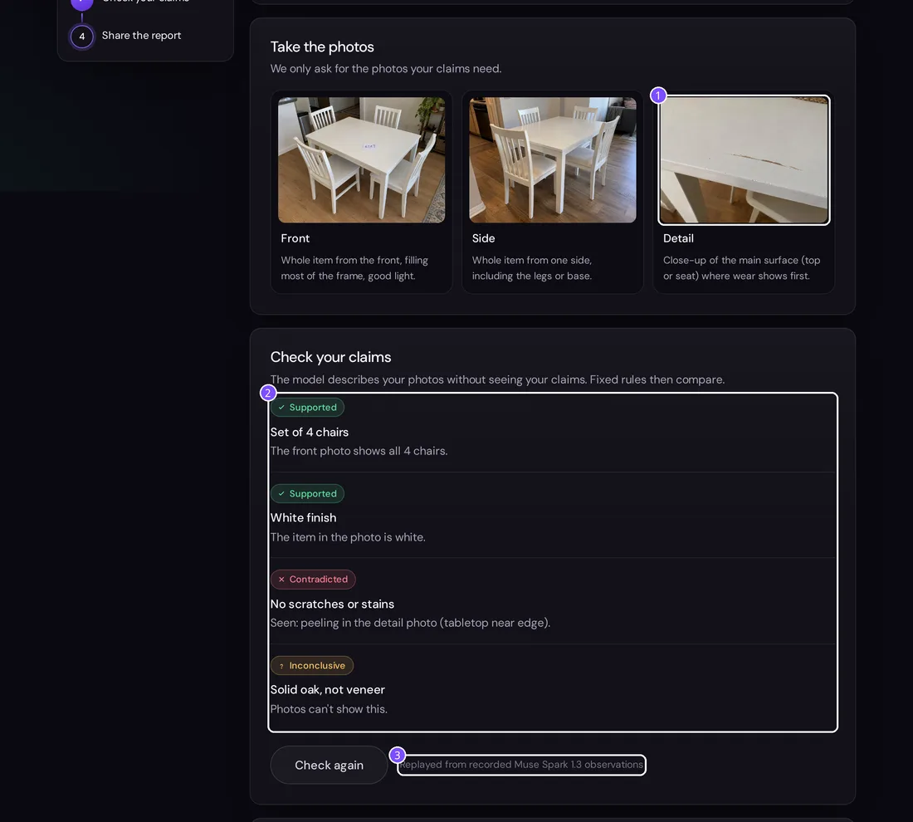
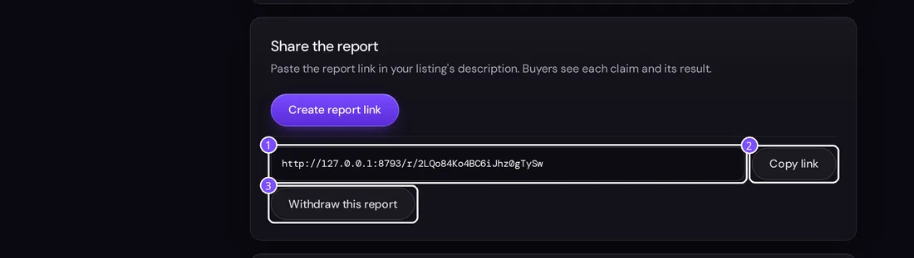
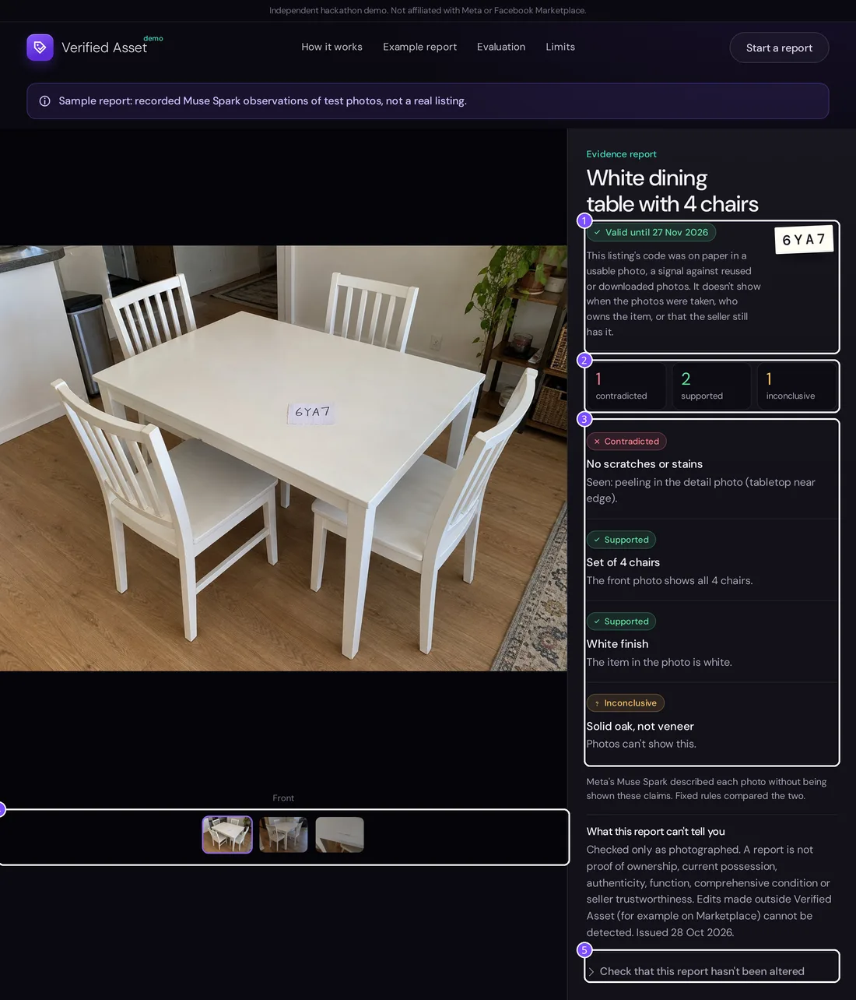
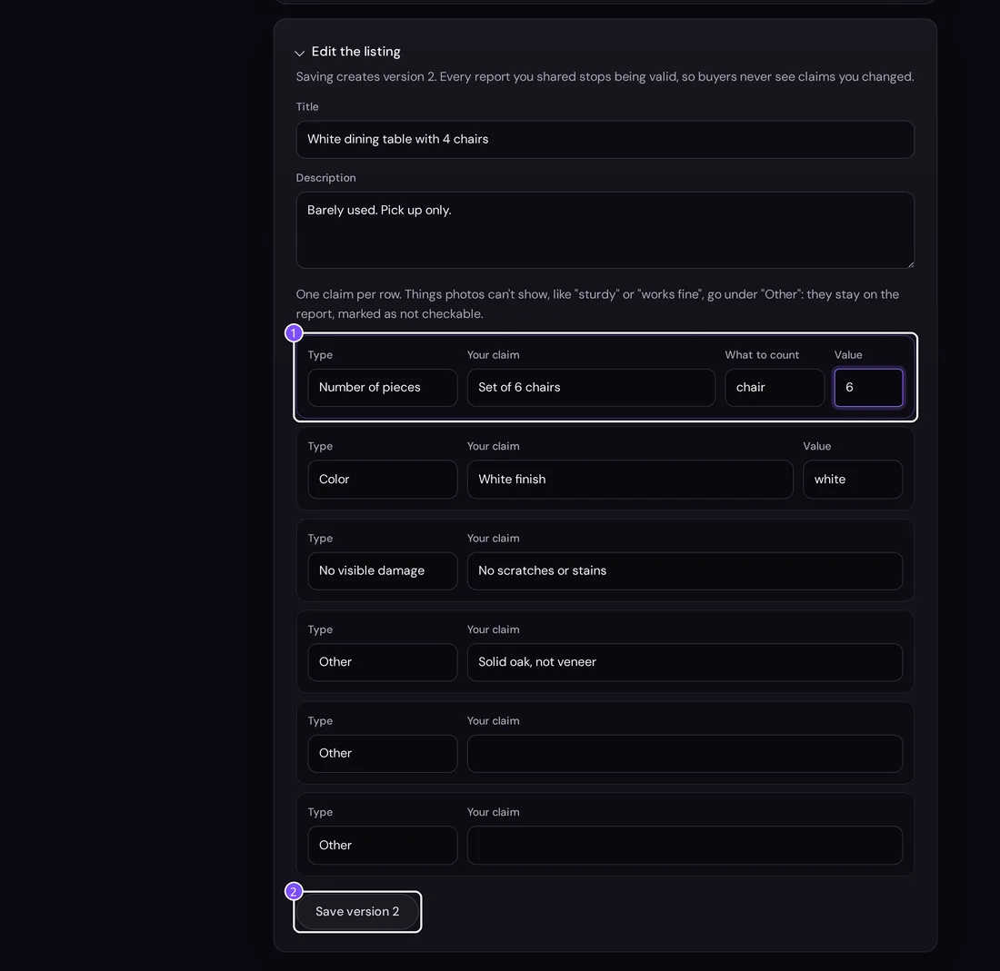
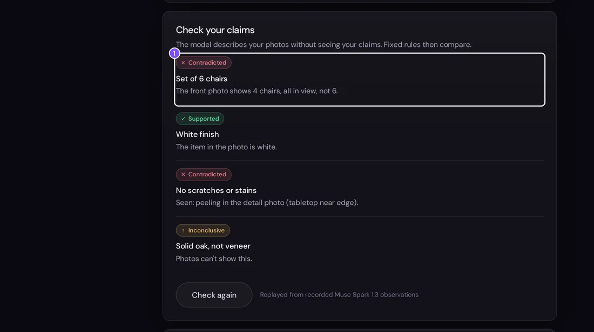
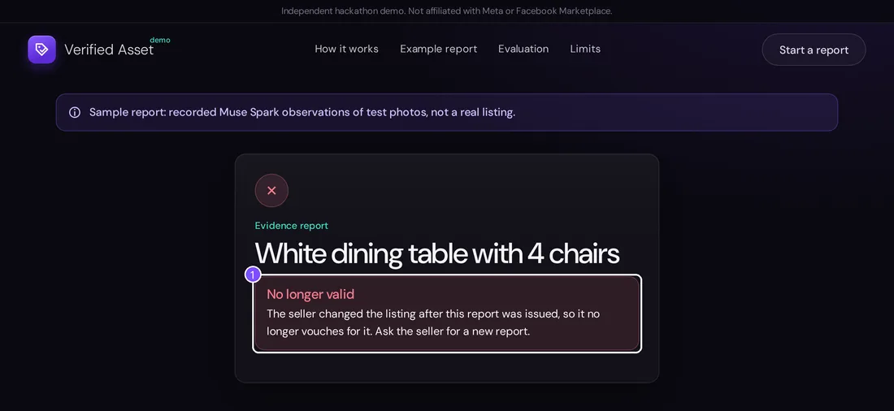
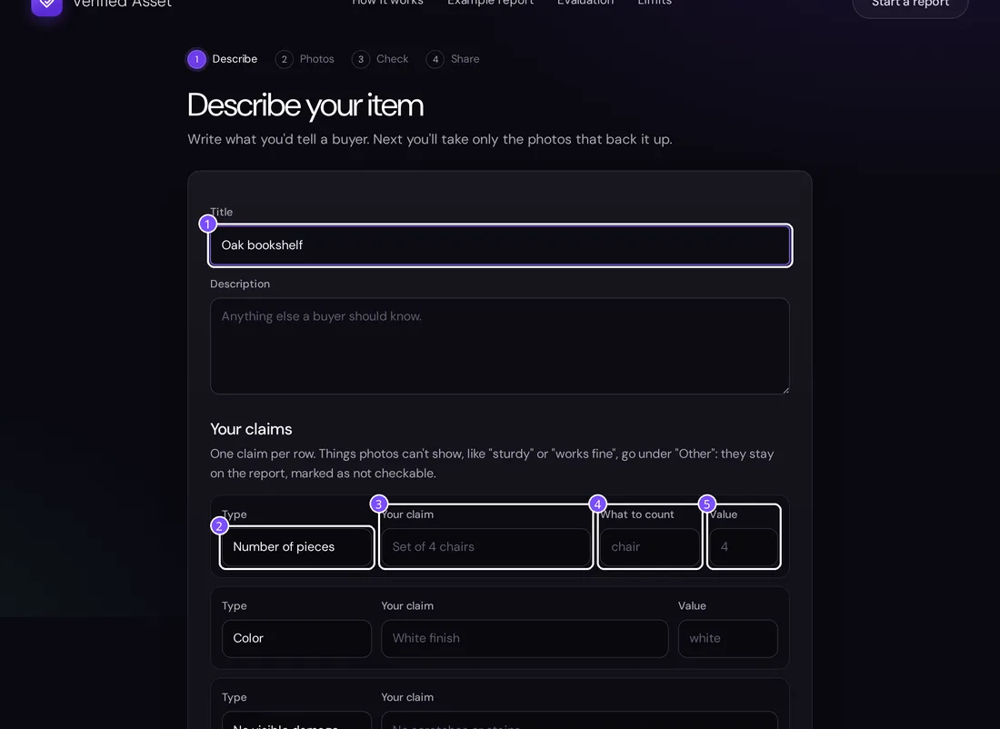

# Verified Asset: demo guide

A step-by-step walk through the live demo at **https://verified.adwentech.com**, with real screenshots. Numbers on each picture match the list under it.

Verified Asset lets a second-hand furniture seller back up what they write in a listing. The seller writes claims, takes the photos those claims need, and Meta's Muse Spark describes each photo **without seeing the claims**. Fixed rules then compare the description with each claim and say what is supported, what is contradicted, and what the photos can't settle. The buyer gets a sealed report link.

There are two ways in:

- **Try the sample** (steps 1 to 9). A dining set we photographed ourselves, with Muse Spark's observations recorded from a real run. It shows the whole flow, costs nothing and calls no model.
- **Start a report** (step 10). Your own item and photos. Live checks call Muse Spark and SAM 3.1, so they only run once the model key is set on the server; until then a live check stops with "no model is configured" and records nothing.

## 1. The home page

1. **Try the sample** opens a ready-made listing with photos, so you can run the check right away.
2. **Start a report** begins your own listing (step 10).
3. **How we measured** jumps to the evaluation: on 12 labelled cases, blind observation plus fixed rules got 12 right with no false reassurance; the model judging the claim directly got 9, and twice said "supported" for a photo too blurry or too dark to tell.

## 2. The seller's page

1. The violet note marks this as the sample: recorded observations of test photos, not a real listing. You can edit the claims and check again; the photos stay fixed.
2. The progress rail: code on paper, photos, check, share. Each step gets a tick when it's done.
3. The listing's capture code. The seller writes it on paper and puts it next to the item in the front photo. It is a signal against reused or downloaded photos, not proof of ownership.
4. The photos. We only ask for the ones the claims need: a count needs front and side, a damage claim adds a close-up. On your own listing, tapping a box opens the camera and the photo uploads as soon as it's chosen.

This page's link is private: anyone with it can edit the listing, which is why the yellow note asks the seller to keep it.

## 3. Checking the claims

1. While the check runs, the page shows what is happening, photo by photo. The model is only told what to count, never the claims.
2. The button stays disabled until the result is back. The sample replays its recording at once; a live check with Muse Spark and SAM 3.1 took about 6.5 seconds and cost about 3.5 cents.

## 4. The result

1. The close-up. Muse Spark reported peeling on the tabletop edge here.
2. One verdict per claim, with the reason in plain words:
   - "Set of 4 chairs": **supported**, the front photo shows all 4.
   - "White finish": **supported**.
   - "No scratches or stains": **contradicted**, peeling seen in the close-up.
   - "Solid oak, not veneer": **inconclusive**, photos can't show this. Claims like this stay on the report, marked as not checkable.
3. Where the result came from: here, the replayed recording. On a live check this line names the models and the time taken.

## 5. Sharing the report

1. **Create report link** gives a public link the seller pastes into the listing's description.
2. **Copy link** puts it on the clipboard.
3. **Withdraw this report** turns the link off for good. Reports also expire after 30 days.

## 6. What the buyer sees

1. Validity and the capture code: the date the report expires, and whether the code on paper was readable in a usable photo.
2. The counts: contradicted, supported, inconclusive.
3. Each claim with its verdict, contradicted first.
4. The photos the verdicts are about. On a phone they swipe.
5. **Check that this report hasn't been altered** opens the SHA-256 fingerprint of the report and of every photo, so anyone can confirm nothing changed after it was issued.

The buyer never sees SAM's boxes or the seller's private page.

## 7. Changing a claim

1. Back on the seller's page, open **Edit the listing** and change "Set of 4 chairs" to "Set of 6 chairs", with 6 as the value. The sentence has to name the same number as the value, or the form refuses it.
2. **Save version 2.** Saving makes a new version, and every report shared for the old version stops being valid.

## 8. Checking again

1. Run the check again: "Set of 6 chairs" is now **contradicted**, because the front photo shows 4 chairs, all in view. A count is only decided from a photo where every piece is fully in view, and counts are never added across photos (the same chair shows up in several). Otherwise the claim stays inconclusive and the page asks for a better photo.

## 9. The old link after the edit

1. The report from step 5 now says **No longer valid**: the seller changed the listing after it was issued, so it no longer vouches for it. The same page appears, with its own wording, for a withdrawn or expired report.

## 10. Starting your own report

1. The title buyers will see.
2. The claim type: number of pieces, color, no visible damage, or other.
3. The claim as you'd write it to a buyer.
4. For a count, what to count ("chair", "shelf").
5. The value to check: the number, or the color.

Then **Continue to photos** and follow steps 2 to 6 with your own item.

## A two-minute run for testers

1. Open https://verified.adwentech.com and press **Try the sample**.
2. Press **Check my claims**. Expect 2 supported, 1 contradicted, 1 inconclusive.
3. Press **Create report link** and open the link in a private window: that is the buyer's view.
4. Back on the seller's page, change the chairs to 6 and save. Check again: the count is now contradicted.
5. Reload the buyer's link: it now says **No longer valid**.
6. Try counting something else in the sample, such as "shelf". The sample only has recorded observations for chairs, so the check stops and says so.

## What is real and what is recorded

- The photos are ours, taken for this demo. No photo from a real listing is ever sent to a model.
- The sample's observations are a recording of a real Muse Spark 1.3 run on those photos. The rules that turn them into verdicts run live, every time.
- The evaluation numbers come from `eval/` in this repository.

Screenshots for this guide come from `docs/guide/shoot.py`, which drives the live site with the sample only.
