# Verified Asset: demo guide

A step-by-step walk through the live demo at **https://verified.adwentech.com**, with real screenshots. Numbers on each picture match the list under it.

Verified Asset lets a second-hand item seller back up what they write in a listing. The seller writes claims, takes the photos those claims need, and Meta's Muse Spark describes each photo **without seeing the claims**. Fixed rules then compare the description with each claim and say what is supported, what is contradicted, and what the photos can't settle. The buyer gets a sealed report link.

The category picker offers Furniture, Phones & tablets, Electronics & gaming, Clothing & shoes, and Kitchen & home. Tap attribute suggestions or add a custom claim. The screenshots below retain the furniture walkthrough.

There are two ways in:

- **Try the sample** (steps 1 to 12). A dining set we photographed ourselves, with Muse Spark's observations recorded from a real run. It shows the whole flow, costs nothing and calls no model.
- **Start a report** (step 13). Your own item and photos. Live checks call Muse Spark and SAM 3.1, so they only run once the model key is set on the server; until then a live check stops with "no model is configured" and records nothing.

The seller's page is four steps: **Code, Photos, Check, Share**. The tabs at the top jump between them, and **Back** and **Next** at the bottom of the screen walk through them in order.

## 1. The home page

1. **Try the sample** opens a ready-made listing, so you can run the check right away.
2. **Start a report** begins your own listing (step 13).
3. **How we measured** jumps to the evaluation: on 12 labelled furniture cases, blind observation plus fixed rules got 12 right with no false reassurance; the model judging the claim directly got 9, and twice said "supported" for a photo too blurry or too dark to tell.

## 2. Code

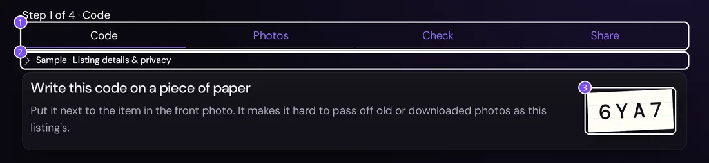

1. The four steps. The sample opens on **Check**; this guide starts from the first one.
2. **Listing details & privacy** holds the sample note (recorded observations of test photos, not a real listing) and, on your own listing, the reminder that this page's link is private: anyone with it can edit the listing.
3. The listing's capture code. The seller writes it on paper and puts it next to the item in the front photo. It is a signal against reused or downloaded photos, not proof of ownership.

## 3. Photos

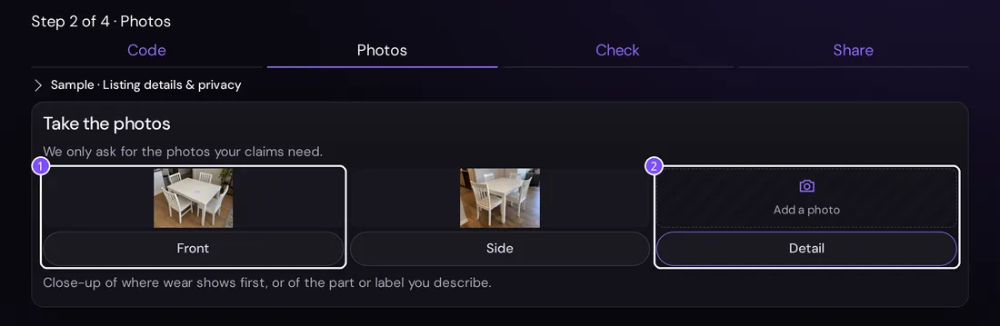

1. We only ask for the photos the claims need: a count needs front and side, a damage claim adds a close-up. On your own listing, tapping a box opens the camera and the photo uploads as soon as it's chosen.
2. The sample starts **without its close-up** on purpose: step 5 shows what happens when a claim needs a photo that isn't there.

## 4. Checking the claims

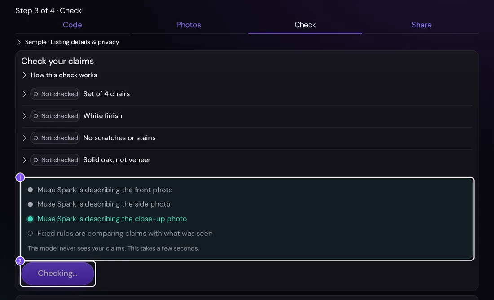

1. While the check runs, the page shows what is happening, photo by photo. The model is only told what to count, never the claims.
2. The button stays disabled until the result is back. The sample replays its recording at once; a live check with Muse Spark and SAM 3.1 took about 6.5 seconds and cost about 3.5 cents.

## 5. The photo Muse Spark asks for

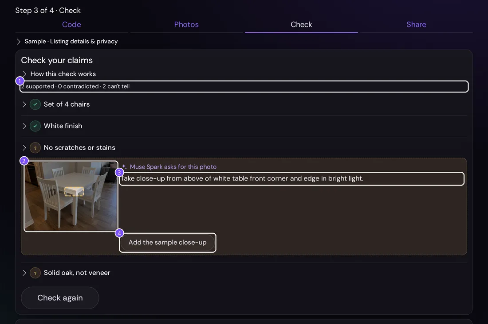

1. The first result: 2 supported, 0 contradicted, 2 can't tell. "No scratches or stains" can't be settled without a close-up.
2. For a claim the photos can't settle, Muse Spark looks at the photos the seller already has and marks where the missing photo should be taken. It is told only the task ("inspect the item's surfaces, edges and corners for damage"), never the seller's claim or its value.
3. The exact photo to take, in one sentence. When one photo would settle several claims, it asks for it once.
4. **Add the sample close-up** stands in for the camera. On your own listing the button reads **Take this close-up** (or the photo it needs) and opens the camera, then brings you back to Check.

The request is shown only to the seller. It never appears on the report and never changes a verdict: only the next check does. The sample shows a recorded request; on your own listing, asking is one more Muse Spark call, made only when a claim can't be told.

## 6. The result

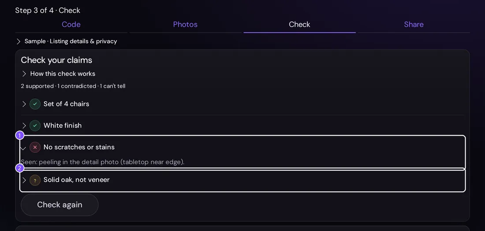

1. Press **Check again**: "No scratches or stains" is now **contradicted**. Tap a claim to see why: peeling on the tabletop edge, seen in the close-up. "Set of 4 chairs" and "White finish" stay **supported**.
2. "Solid oak, not veneer" stays **can't tell**: photos can't show this. Claims like this stay on the report, marked as not checkable.

## 7. Sharing the report

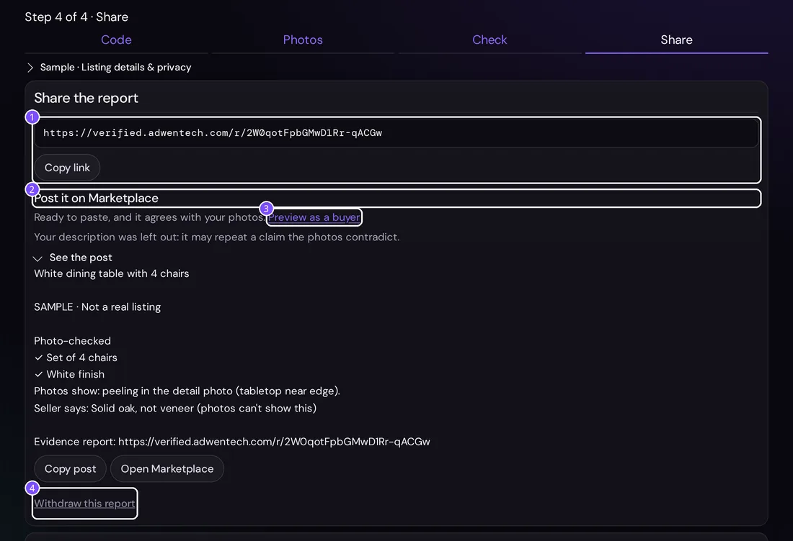

1. **Create report link** gives a public link the seller pastes into the listing's description. **Copy link** puts it on the clipboard; on a phone, **Share** opens the phone's share sheet (WhatsApp, Messenger).
2. **Post it on Marketplace**: a title and description ready to paste, with the photo-checked claims and the link. The seller's own description is left out when it may repeat a claim the photos contradict. **See the post** shows it, **Copy post** copies it and **Open Marketplace** opens the listing form.
3. **Preview as a buyer** shows the report inside a mock listing (step 9).
4. **Withdraw this report** turns the link off for good. Reports also expire after 30 days.

## 8. What the buyer sees

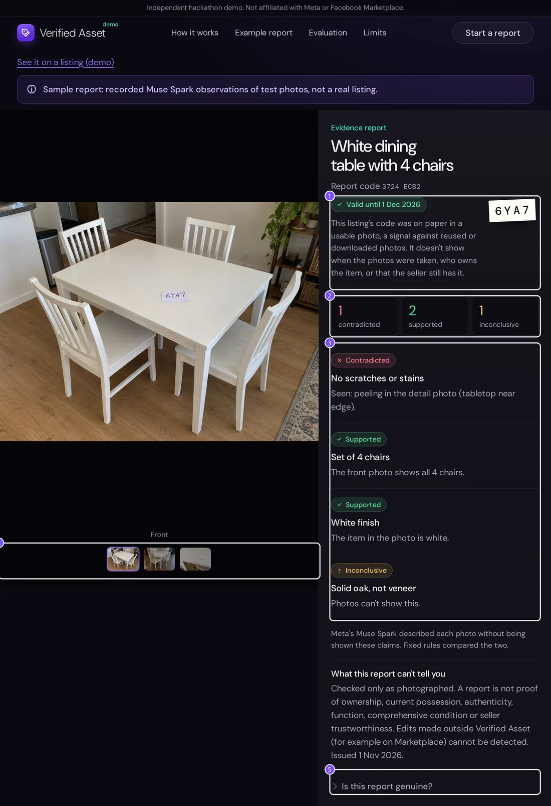

1. Validity and the capture code: the date the report expires, and whether the code on paper was readable in a usable photo.
2. The counts: contradicted, supported, inconclusive.
3. Each claim with its verdict, contradicted first.
4. The photos the verdicts are about. On a phone they swipe.
5. **Is this report genuine?** shows an eight-character report code, also visible in the header. Ask for the link on verified.adwentech.com if given a screenshot, compare the code and check the current validity. The section explains when the check ran, which photos it covered, expiration, the model and the rule-set date. Times display in the reader's local timezone, with UTC as the no-JavaScript fallback. Text edits here invalidate the report; replacing a photo leaves the report tied to its original photos. **Technical details** contains the full report and photo SHA-256 codes and listing version. The public API does not expose the complete payload for independent recalculation; a matching short code alone is not proof of authenticity.

The buyer never sees SAM's boxes or the seller's private page.

## 9. The report inside a listing

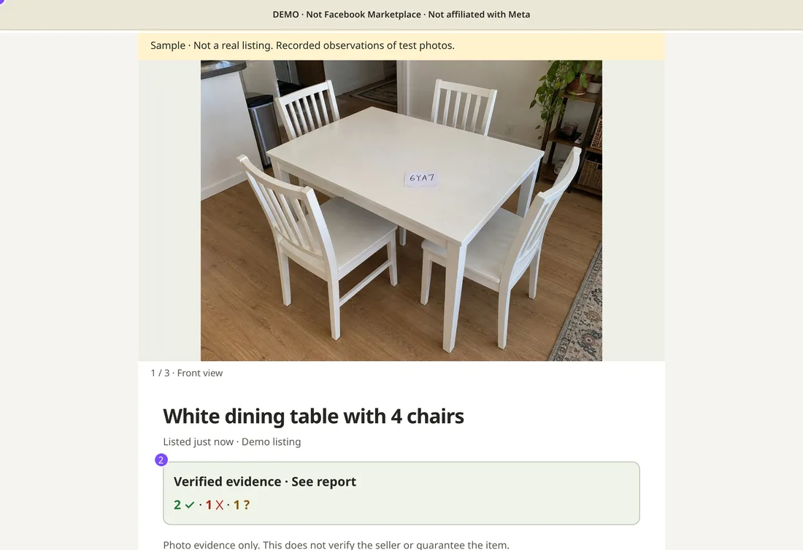

1. A mock Marketplace-style listing, labelled **DEMO** and not affiliated with Meta.
2. The evidence card a buyer would see under the photos: the counts, and a link to the full report.

## 10. Changing a claim

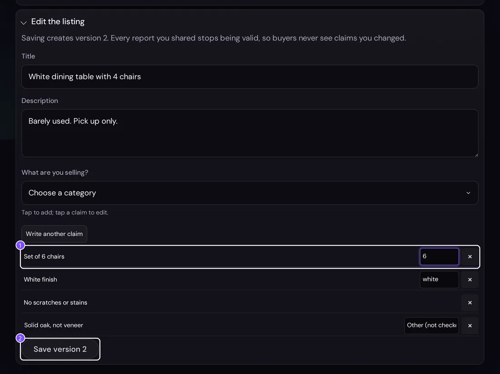

1. Back on the seller's page, open **Edit the listing**, tap "Set of 4 chairs" and change it to "Set of 6 chairs", with 6 as the number. The sentence has to name the same number as the value, or the form refuses it.
2. **Save version 2.** Saving makes a new version, and every report shared for the old version stops being valid.

## 11. Checking again

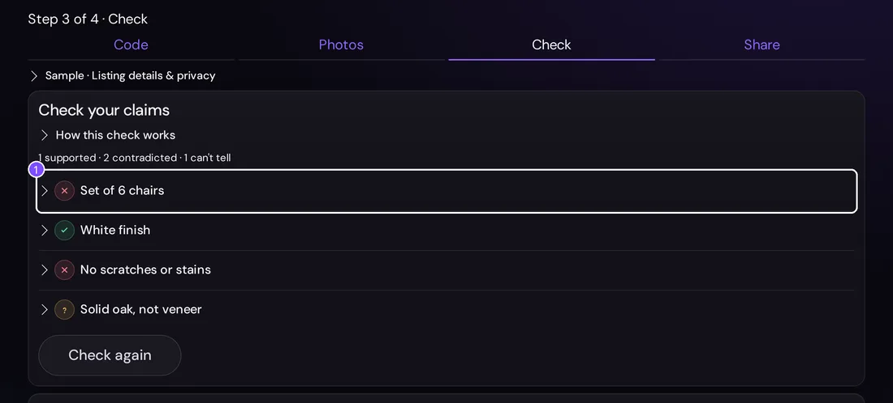

1. Run the check again: "Set of 6 chairs" is now **contradicted**, because the front photo shows 4 chairs, all in view. A count is only decided from a photo where every piece is fully in view, and counts are never added across photos (the same chair shows up in several). Otherwise the claim stays can't tell and Muse Spark asks for a better photo.

## 12. The old link after the edit

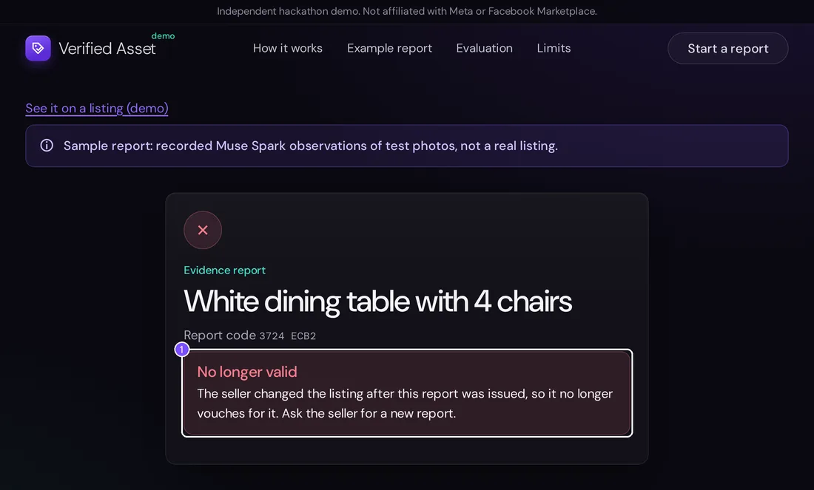

1. The report from step 7 now says **No longer valid**: the seller changed the listing after it was issued, so it no longer vouches for it. The same page appears, with its own wording, for a withdrawn or expired report.

## 13. Starting your own report

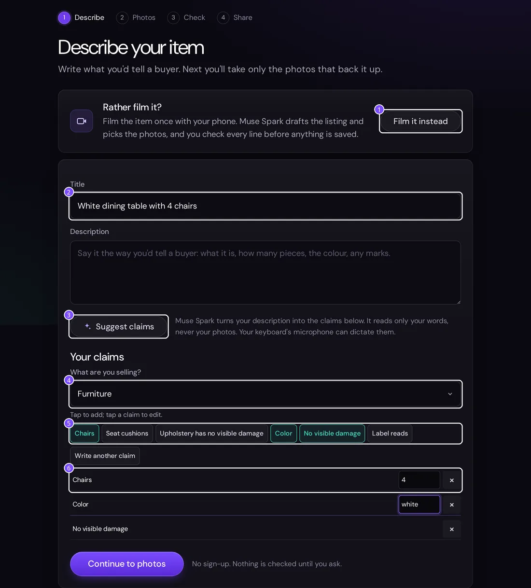

1. **Film it instead** skips the typing: see step 14.
2. The title buyers will see.
3. **Suggest claims** fills the claims for you. Write or dictate the description the way you'd tell a buyer, press it, and Muse Spark turns your words into claims marked *Suggested*. It reads only the description, never the photos. It takes about 6 seconds and needs the model key on the server.
4. The category: Furniture, Phones & tablets, Electronics & gaming, Clothing & shoes, or Kitchen & home.
5. Tap the attributes buyers ask about. **Write another claim** adds one in your own words.
6. Each claim, with the value to check where it needs one: the number, the colour or the label text. Tap a claim to reword it; × removes it. Label text does not certify brand authenticity.

Then **Continue to photos** and follow steps 2 to 7 with your own item.

## 14. Filming instead

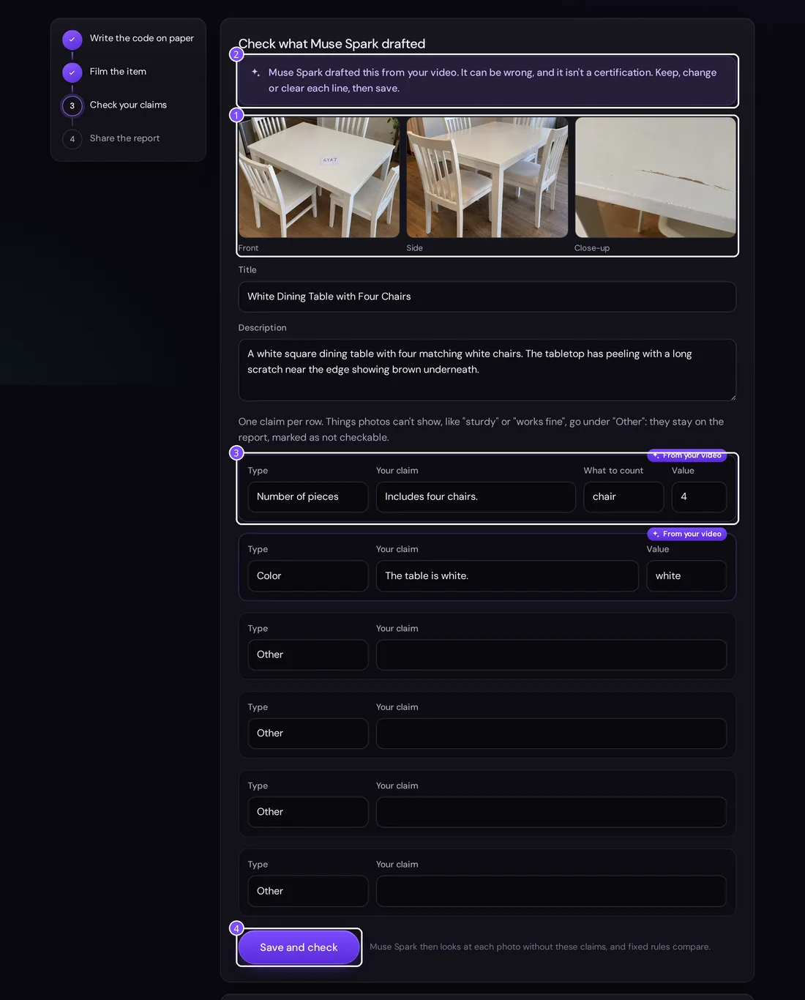

Write the listing's code on paper, press **Film it instead** and film 10 to 30 seconds: the front with the paper in view, one side, then close on the top. The phone keeps the video and sends only 10 still frames. About 15 seconds later the draft appears.

1. The front, side and close-up photos Muse Spark picked from the frames. They become the listing's photos.
2. The draft is marked as Muse Spark's: it can be wrong, and it isn't a certification.
3. Muse Spark drafts the title and description, plus only counts and colours, each marked *From your video*. It never drafts "no visible damage": damage it sees goes in the description, and that claim stays the seller's to make. Editing a row makes it the seller's.
4. **Save and check** saves the listing and runs the same blind check as step 4. On the report, each claim it drafted says *Drafted by Muse Spark from the seller's video; the seller kept this wording*.

It needs the model key on the server, and each phone can film 10 items a day.

## A two-minute run for testers

1. Open https://verified.adwentech.com and press **Try the sample**. It opens on the Check step.
2. Press **Check my claims**. Expect 2 supported, 0 contradicted, 2 can't tell, and Muse Spark asking for a close-up of the tabletop edge.
3. Press **Add the sample close-up**, then **Check again**. Expect 2 supported, 1 contradicted, 1 can't tell.
4. Press **Next**, then **Create report link**, and open the link in a private window: that is the buyer's view. **Preview as a buyer** shows it inside a mock listing.
5. Back on the seller's page, change the chairs to 6 and save. Check again: the count is now contradicted.
6. Reload the buyer's link: it now says **No longer valid**.

## What is real and what is recorded

- The photos are ours, taken for this demo. No photo from a real listing is ever sent to a model.
- The sample's observations are a recording of a real Muse Spark 1.3 run on those photos. The rules that turn them into verdicts run live, every time.
- The evaluation numbers come from `eval/` in this repository: 12 furniture cases, not a validation of the new categories or part/label rules.

Screenshots for this guide come from `docs/guide/shoot.py`, which drives the live site with the sample only.
